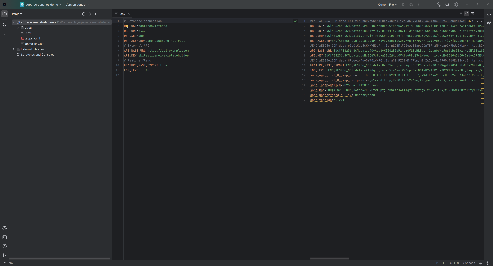

# SOPS Editor for JetBrains IDEs

Edit [SOPS](https://github.com/getsops/sops)-encrypted files directly in your IDE. The plugin opens a split view with the decrypted content on one side and the raw ciphertext on the other, and re-encrypts the file when you save.



## Features

- Split-view editor with the decrypted content on the left and the encrypted content on the right
- Re-encrypt automatically on save (toggle in settings), or save by hand with **Encrypt with SOPS**
- Decrypted diffs: VCS history, local changes and compare with revision show the plaintext of SOPS files side by side, read-only, with the ciphertext one click away
- Plaintext reaches `sops` through stdin, so no plaintext temporary files are written (sops 3.10 or newer)
- Supports `.env`, YAML, JSON, INI and binary (`.sops`, `.bin`) files (same list as the `sops` CLI itself)
- Context menu actions for Encrypt, Decrypt and New SOPS Encrypted File, plus `Ctrl+Alt+E` and `Ctrl+Alt+D` shortcuts
- A setup validator that checks your `sops` binary, age key and environment in one click
- Auto-detects the `sops` binary on `PATH`, with fallbacks for Chocolatey, Homebrew and `/usr/local/bin`
- Log file with secret masking for AGE keys, PEM private keys and SSH keys. Rotates at 5 MB, owner-only permissions

## Requirements

- A JetBrains IDE from 2024.2 onwards. Newer builds are supported too.
- The [`sops`](https://github.com/getsops/sops/releases) binary on your `PATH`, or a full path configured in settings. Version 3.10 or newer is recommended: older versions work, but saving then goes through a short-lived plaintext temporary file (see [SECURITY.md](SECURITY.md))
- An [age](https://github.com/FiloSottile/age) key file or a configured PGP key that `sops` can use to decrypt

### Verified compatibility

The JetBrains Plugin Verifier passes against the IDE versions in the table below. The matrix is declared in `build.gradle.kts` under `pluginVerification.ides` and needs to be run locally with `./gradlew verifyPlugin` before cutting a release. GitHub Actions does not run it because downloading eleven full IDE distributions exceeds the free disk space on the hosted runners.

Other JetBrains IDEs on the same platform builds should work too but are not explicitly tested.

| IDE                      | 2024.2 | 2024.3 | 2025.1 | 2025.2 | 2025.3 | 2026.1 | 2026.2 |
|--------------------------|--------|--------|--------|--------|--------|--------|--------|
| IntelliJ IDEA Community  |   ✓    |   ✓    |   ✓    |   ✓    |        |        |        |
| IntelliJ IDEA Ultimate   |        |        |        |        |   ✓    |   ✓    |   ✓    |
| PhpStorm                 |   ✓    |        |        |        |   ✓    |   ✓    |   ✓    |

From 2025.3 onward, JetBrains stopped publishing IntelliJ IDEA Community as a separate Maven artifact for plugin development. The unified IDEA Ultimate distribution is what the verifier runs against for those builds.

Default age key locations: `~/.config/sops/age/keys.txt` on Linux and macOS, `%APPDATA%\sops\age\keys.txt` on Windows.

## Installation

### From the JetBrains Marketplace

1. Open **Settings → Plugins → Marketplace**
2. Search for **SOPS Editor**
3. Click **Install** and restart the IDE

### From a release archive

1. Download `sops-editor-plugin-<version>.zip` from the [Releases](https://github.com/0skater0/sops-editor-plugin/releases) page
2. In the IDE: **Settings → Plugins → ⚙ → Install Plugin from Disk...**
3. Pick the ZIP and restart the IDE

## Configuration

Open **Settings → Tools → SOPS Editor**.

| Setting                              | What it does |
|--------------------------------------|--------------|
| SOPS executable path                 | Path to the `sops` binary. Auto-detected from `PATH` on first start. The Verify button runs `sops --version` against it. |
| SOPS executable in WSL               | Command or absolute Linux path of `sops` inside WSL, used for files stored in a WSL distribution. Default is `sops` from the login shell `PATH`. See [Projects in WSL](#projects-in-wsl). |
| Age key file                         | Path to your age key file. Supports `~`, `$HOME`, `${VAR}`, `%APPDATA%`, `%USERPROFILE%`. |
| Automatically re-encrypt on save     | When on, Ctrl+S re-encrypts silently. When off, Ctrl+S leaves the file on disk unchanged and you save with **Encrypt with SOPS** (`Ctrl+Alt+E`) in the SOPS editor. See [Saving by hand](#saving-by-hand). |
| Encrypted side editable              | Normally the right pane is read-only. Enable this to edit raw ciphertext directly. Meant for debugging. |
| Show decrypted content in diffs      | Offers the **SOPS: decrypted** viewer for diffs of SOPS files. On by default. See [Decrypted diffs](#decrypted-diffs). |
| Custom environment variables         | Extra `KEY=VALUE` pairs passed to the `sops` subprocess. Useful for `SOPS_PGP_FP`, `AWS_PROFILE` and similar. |
| Log directory                        | Where the rotating log file lives. Default is the system temp directory. |

Hit **Validate Setup** at the bottom of the dialog to run a full check of the binary, key file and environment.

## Projects in WSL

On Windows, files stored inside a WSL distribution (paths starting with `\\wsl.localhost\` or `\\wsl$\`) are handled by `sops` inside that distribution, not by the Windows binary. The plugin runs it through a login shell of your default WSL user, with Linux paths and the file's folder as working directory, so the `.sops.yaml` creation rules of the project apply as they do in a WSL terminal.

- Install `sops` in the distribution. If it is not on the login shell `PATH`, set **SOPS executable in WSL** to its absolute Linux path.
- The **Age key file** setting is a Windows path and is not passed to WSL. `sops` uses its default key file there, `~/.config/sops/age/keys.txt`, unless you set `SOPS_AGE_KEY_FILE` (or another `SOPS_*` variable) under **Custom environment variables** with a Linux path.
- Custom environment variables are set before the login shell reads your profile. If `~/.profile` or a similar login script sets the same variable, the profile value wins.
- Output that your login profile prints before `sops` runs is filtered out. Output printed afterwards, for example by a logout script, is not filtered, so keep logout scripts quiet.
- Login profile scripts must not read from stdin. They share stdin with `sops`, which receives the text to encrypt or decrypt through it, so a script that reads input would take part of that text.
- When saving, the plaintext is passed to `sops` in WSL through stdin if it is version 3.10 or newer. With an older `sops` the plugin writes a short-lived temporary file next to the SOPS file in WSL and deletes it right after the `sops` call. See [SECURITY.md](SECURITY.md) for its permissions.

## `.sops.yaml` rules on Windows

The Windows build of `sops` matches `path_regex` against the file path relative to `.sops.yaml` with Windows separators, for example `secrets\a.yaml`. A rule written as `secrets/.*\.yaml$` therefore matches in WSL, Linux and macOS but not on Windows, and encrypting fails with `no matching creation rules found`. Accept both separators:

```yaml
creation_rules:
  - path_regex: secrets[\\/].*\.(yaml|env)$
    age: age1...
```

Projects stored in WSL are encrypted by `sops` inside the distribution with Linux paths, so `secrets/` works there.

## Usage

### Opening an existing SOPS file

Open any SOPS-encrypted file from the project view. The split editor opens automatically with plaintext on the left and ciphertext on the right. Edit the left side and save with `Ctrl+S`. The file on disk is encrypted again according to the `creation_rules` in your `.sops.yaml`: a file whose current recipients differ from the matching rule gets the rule's recipients, and if no rule matches the file, saving fails with an error and the file stays unchanged.

### Saving by hand

With **Automatically re-encrypt on save** turned off, `Ctrl+S` does not touch the file on disk. Save the changes from the split editor with **Encrypt with SOPS**: press `Ctrl+Alt+E` in the editor or pick it from the editor tab's context menu. It encrypts the current plaintext of the left pane and writes it, the same way the automatic save does. The action is greyed out while there are no unsaved changes.

### Decrypted diffs

When a diff shows a SOPS file, for example **Show Diff** in the Git history, the diff of local changes in the commit window, or **Compare with Revision**, both sides normally show ciphertext. The plugin adds a viewer named **SOPS: decrypted** to the viewer switcher in the diff toolbar, next to **Side-by-side viewer** and **Unified viewer**. It decrypts each side through `sops` in the background and shows the plaintext side by side:

- The side titles end in **(decrypted)** and a banner with an open lock icon says that the view is read-only. Switch to **Side-by-side viewer** to see the ciphertext again.
- The IDE remembers your last viewer choice. If you picked another viewer before, switch to **SOPS: decrypted** once.
- If a side cannot be decrypted, for example because the key is missing or `sops` is not installed, the banner says why and the side shows a placeholder. The other viewers keep working.
- A side that is not encrypted, for example the revision before a file was first encrypted, is shown as it is.
- Older revisions are not on disk, so they are passed to `sops` through stdin. For projects in WSL this happens inside the distribution. The plaintext is held in memory only while the diff is open.
- The **All-in-One Diff**, which shows all changed files in one scrollable view, only offers the IDE's own viewers; plugins have no public way to add one there. It is off by default. If you turned it on under **Settings → Advanced Settings → Version Control**, use **Compare with Revision** or turn it off to get **SOPS: decrypted** in the commit window.

Turn the viewer off with **Show decrypted content in diffs** in the settings.

### Creating a new SOPS file

Right-click in the project view, then **New → SOPS Encrypted File**. Pick a name, pick a format, and the plugin encrypts a starter template and creates the file with the ciphertext. If encryption fails, for example because no `.sops.yaml` rule matches the folder, no file is created and a notification shows the error.

Filenames are validated. Letters, digits, dots, underscores and dashes only. Anything that looks like path traversal (`../evil.env`, `/etc/passwd`, drive letters) is rejected before the file is created.

### Encrypting a plaintext file

Right-click a plaintext file in the project view or on its editor tab, then **Encrypt with SOPS**. In the project view the action only appears on files that are not already encrypted; in the SOPS split editor it saves your changes instead (see [Saving by hand](#saving-by-hand)). Default shortcut is `Ctrl+Alt+E`.

### Decrypting in place

Right-click a SOPS file, then **Decrypt with SOPS**. The file on disk is overwritten with its plaintext. Useful when you are migrating off SOPS, or handing the file to a tool that does not understand the SOPS envelope. Default shortcut is `Ctrl+Alt+D`.

## Troubleshooting

### "SOPS not found"

The Verify button in settings came back red. Try this in order:

1. Is `sops` actually installed? Run `sops --version` in a terminal.
2. Is it on `PATH`? If not, set an absolute path in **Settings → Tools → SOPS Editor → SOPS executable path**.
3. Run **Validate Setup** for the exact error message.

### "No AGE-SECRET-KEY entries found"

Your age key file exists but has no usable private key. Generate one with `age-keygen -o ~/.config/sops/age/keys.txt` and point plugin settings at that file.

### Where is the log?

**Settings → Tools → SOPS Editor → Open Log File**. Default location:

- Linux and macOS: `/tmp/sops-editor-plugin/sops-editor.log`
- Windows: `%TEMP%\sops-editor-plugin\sops-editor.log`

The log rotates at 5 MB and keeps three rotated files. Secrets are masked before writing, but treat the file as sensitive anyway and only share redacted excerpts when asking for help.

## Development

```bash
./gradlew buildPlugin    # ZIP under build/distributions/
./gradlew runIde         # sandbox IDE with the plugin loaded
./gradlew test           # unit tests
./gradlew verifyPlugin   # Plugin Verifier against the compatibility matrix
```

You need JDK 21 to build.

## Contributing

Issues and pull requests are welcome. [CONTRIBUTING.md](CONTRIBUTING.md) covers the dev setup and the conventions.

## License

[MIT](LICENSE).

## Credits

- [SOPS](https://github.com/getsops/sops), the CLI tool this plugin wraps, now maintained under the CNCF.
- The IntelliJ Platform team for `TextEditorWithPreview`, which the split view is built on.
